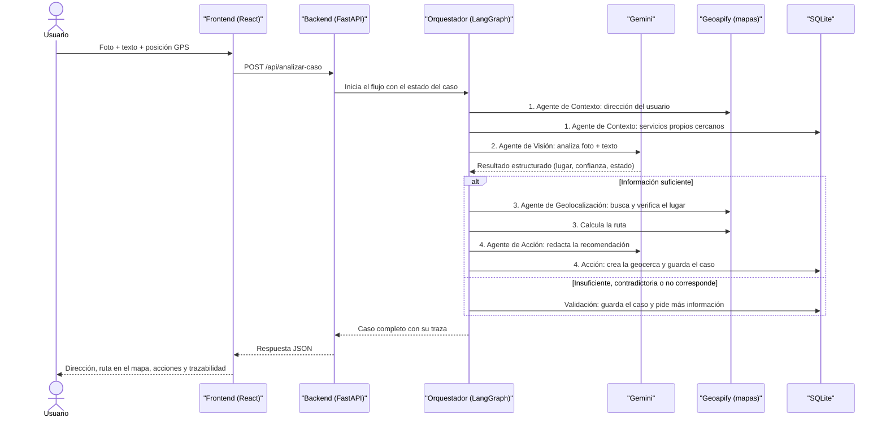
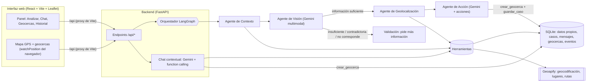

# 🗺️ TABOGO MAPS IA

**Solución inteligente multimodal de movilidad y localización de servicios urbanos, con herramientas, geolocalización y agentes.**

| | |
|---|---|
| **Actividad** | Actividad entregable – Unidad III |
| **Institución** | UNIMINUTO |
| **Integrantes** | Miguel Gallegos · Laura Tinjaca  |

---

## 📌 Resumen en una frase

TABOGO MAPS IA es una aplicación web que funciona como un **mapa-GPS inteligente**: te ubica en tiempo real, te avisa cuando entras o sales de una **geocerca**, y si le tomas una **foto de un lugar**, una IA lo identifica, **lo verifica en un servicio de mapas real** y te da la **dirección y la ruta**. Además tiene un chat que responde preguntas sobre cada caso usando herramientas, y varios agentes coordinados que dejan registro de todo lo que hicieron.

## 📚 Contenido

1. [¿Qué problema resuelve?](#1-qué-problema-resuelve)
2. [Qué hicimos (visión general)](#2-qué-hicimos-visión-general)
3. [Así funciona un caso, paso a paso](#3-así-funciona-un-caso-paso-a-paso)
4. [Arquitectura implementada](#4-arquitectura-implementada)
5. [Agentes y orquestación](#5-agentes-y-orquestación)
6. [Herramientas y acciones](#6-herramientas-y-acciones)
7. [Cómo evitamos que la IA invente datos](#7-cómo-evitamos-que-la-ia-invente-datos)
8. [Mapa GPS y geocercas](#8-mapa-gps-y-geocercas)
9. [Modelo de IA, mapas y otras decisiones técnicas](#9-modelo-de-ia-mapas-y-otras-decisiones-técnicas)
10. [Persistencia y trazabilidad](#10-persistencia-y-trazabilidad)
11. [Estructura del repositorio](#11-estructura-del-repositorio)
12. [Instalación y ejecución](#12-instalación-y-ejecución)
13. [Guion de demostración](#13-guion-de-demostración)
14. [Mejoras y ajustes realizados durante el desarrollo](#14-mejoras-y-ajustes-realizados-durante-el-desarrollo)
15. [Cumplimiento de la actividad, fase por fase](#15-cumplimiento-de-la-actividad-fase-por-fase)
16. [Preguntas probables en la sustentación](#16-preguntas-probables-en-la-sustentación)
17. [Limitaciones y trabajo futuro](#17-limitaciones-y-trabajo-futuro)
18. [Seguridad](#18-seguridad)
19. [Glosario](#19-glosario)

---

## 1. ¿Qué problema resuelve?

En una ciudad como Bogotá es común necesitar dos cosas: **saber dónde estás o qué lugar tienes enfrente**, y **encontrar o llegar a un servicio** (una estación de carga, un parqueadero, un hospital, un sitio turístico). Un chatbot normal solo conversa. Nuestra solución va más allá:

- **Recibe varios tipos de información:** texto, una foto y la ubicación GPS del usuario.
- **Consulta datos propios** (una base de datos con servicios y lugares) **y un servicio externo de mapas** (Geoapify).
- **Usa herramientas** y **agentes especializados** que cooperan.
- **Ejecuta acciones reales** dentro del sistema (crea una geocerca y guarda el caso), no solo las describe.
- **Deja trazabilidad** para poder explicar cómo se llegó al resultado.

---

## 2. Qué hicimos (visión general)

Construimos una aplicación con **frontend** (lo que ve el usuario) y **backend** (donde ocurre la inteligencia):

| Lo que pidió la actividad | Lo que implementamos |
|---|---|
| Aplicación web con interfaz | Interfaz en **React + Vite** con 4 pestañas (Analizar, Chat, Geocercas, Historial) y un mapa siempre visible |
| Mapa que funcione como GPS | Mapa **Leaflet + OpenStreetMap** con posición en vivo, dirección actual, búsqueda de lugares y **ruta** con distancia, tiempo y pasos |
| Geocerca | Círculos con nombre y radio; el navegador detecta **entradas y salidas**, muestra alertas y guarda cada evento |
| IA que identifica un lugar por foto | **Gemini** (modelo multimodal) analiza la foto + el texto y devuelve un resultado estructurado; el mapa **verifica** el lugar y entrega la dirección |
| Resultado estructurado (no solo texto) | Esquema definido con **Pydantic**: tipo de solicitud, lugar, texto visible, confianza, hechos vs. hipótesis, estado de la información… |
| Detectar información insuficiente, contradictoria o que no corresponde | El orquestador lo detecta, **pide más datos y no ejecuta acciones** |
| Datos propios | Base de datos **SQLite** con servicios y lugares (editables) |
| Servicio externo de mapas | **Geoapify** (geocodificación, lugares cercanos y rutas) con respaldo en OpenStreetMap/Nominatim + OSRM |
| Herramientas (1 de datos propios, 1 de mapas, 1 acción) | 1 de datos propios, 4 de mapas y 1 acción (`crear_geocerca`), todas con registro de uso |
| Chat contextual | Chat por caso con **function calling**: el modelo decide qué herramienta usar |
| Mínimo 2 agentes con orquestación | **4 agentes** + 1 nodo de validación, orquestados con **LangGraph** |
| Persistencia y trazabilidad | **SQLite** + traza por caso (qué agente/herramienta participó, con qué entrada, resultado y tiempo) |
| Repositorio con README y `.env.example` | Este README y `backend/.env.example` (sin claves reales) |

---

## 3. Así funciona un caso, paso a paso

**Ejemplo:** el usuario está en el centro de Bogotá, toma una foto de la fachada de un museo con letrero visible y escribe *“¿Qué lugar es este y cómo llego?”*.



En palabras simples:

1. **Contexto:** se averigua dónde está el usuario (dirección real) y qué servicios propios hay cerca.
2. **Visión:** la IA mira la foto y el texto y propone qué lugar es, con **pistas visuales**, **texto visible** y un nivel de **confianza**.
3. **Decisión del orquestador:** si la información alcanza, sigue; si no, se detiene y pregunta.
4. **Geolocalización:** busca ese lugar en el servicio de mapas y en los datos propios, **comprueba que coincida** y calcula la ruta.
5. **Acción:** redacta la respuesta usando **solo los datos consultados**, **crea una geocerca** alrededor del destino y **guarda el caso**.
6. **Después**, el usuario puede abrir el **chat** y preguntar cosas del caso.

---

## 4. Arquitectura implementada



| Componente | Implementación |
|---|---|
| **Interfaz web** | React 19 + Vite. Mapa con Leaflet y teselas de OpenStreetMap (no requiere clave). El frontend llama a `/api/...` y Vite lo reenvía al backend (proxy). |
| **Backend** | Python + FastAPI (`backend/main.py`) |
| **Modelo de IA** | Google Gemini (`gemini-3.8-flash`), configurable con la variable `GEMINI_MODEL` |
| **Datos propios** | SQLite: tabla `servicios` (se carga desde `backend/datos/servicios_seed.json`) y tablas de casos, mensajes, geocercas y eventos |
| **Servicio externo de mapas** | **Geoapify**. Si no hay clave, usa automáticamente Nominatim (OpenStreetMap) + OSRM público |
| **Herramientas** | `backend/herramientas.py` |
| **Agentes y coordinación** | `backend/agentes.py` (LangGraph) |
| **Acciones del sistema** | Crear geocerca, guardar caso, registrar eventos de entrada/salida |

---

## 5. Agentes y orquestación

### ¿Por qué son agentes y no “prompts con nombre”?
Cada agente es **una función distinta** dentro del flujo, con **su propia responsabilidad, sus propias herramientas y su propia salida**, y todos comparten un **estado común** que viaja por el grafo. Dos de ellos ni siquiera usan IA generativa: trabajan con herramientas y reglas. Eso evidencia una **separación real de responsabilidades**.

| Agente | Responsabilidad | Qué recibe | Herramientas que usa | Qué produce |
|---|---|---|---|---|
| **1. Contexto** *(sin IA generativa)* | Reunir la ubicación y los datos propios cercanos | GPS del usuario, o coordenadas EXIF de la foto | `geocodificar_inverso`, `consultar_servicios_propios` | Dirección del usuario y servicios cercanos |
| **2. Visión** *(Gemini multimodal)* | Analizar texto + foto | Descripción, foto y contexto | — | Un `AnalisisIA` estructurado |
| **3. Geolocalización** *(sin IA generativa)* | Localizar y **verificar** el lugar contra mapas y datos propios; calcular la ruta | El análisis + la ubicación | `geocodificar`, `buscar_lugares_cercanos`, `consultar_servicios_propios`, `calcular_ruta` | Candidatos, destino, nivel de verificación y ruta |
| **4. Acción** *(Gemini + código)* | Redactar la recomendación **solo con datos consultados** y **ejecutar acciones** | El resultado geográfico | `crear_geocerca` y guardado del caso | Recomendación + acciones ejecutadas |

### Mecanismo de orquestación (LangGraph)
El orden es: **Contexto → Visión → (decisión) → Geolocalización → Acción**.

La **decisión** la toma la función `decidir_ruta`, que manda el caso al nodo de **Validación** (sin ejecutar acciones) cuando:
- la IA marca la información como *insuficiente*, *contradictoria* o *no corresponde*;
- no se pudo identificar el lugar con certeza;
- falta la ubicación del usuario para buscar servicios o calcular rutas;
- la solicitud no es identificar un lugar, buscar un servicio ni pedir una ruta.

Así el orden y las condiciones de participación de cada agente quedan explícitas en el código (`crear_orquestador()` en `backend/agentes.py`).

---

## 6. Herramientas y acciones

| Herramienta | Tipo | Qué hace |
|---|---|---|
| `consultar_servicios_propios` | **Datos propios** | Consulta la base de datos por categoría, texto y cercanía |
| `geocodificar` | **Servicio de mapas** | Convierte un nombre o dirección en coordenadas reales |
| `geocodificar_inverso` | **Servicio de mapas** | Convierte coordenadas en una dirección legible |
| `buscar_lugares_cercanos` | **Servicio de mapas** | Encuentra lugares reales de una categoría cerca de un punto (12 categorías: combustible, carga eléctrica, parqueadero, transporte público, salud, farmacia, seguridad, alimentación, supermercado, turismo, educación, alojamiento) |
| `calcular_ruta` | **Servicio de mapas** | Devuelve distancia, tiempo, pasos y el trazado de la ruta |
| `crear_geocerca` | **ACCIÓN** | Inserta una geocerca en la base de datos; aparece de inmediato en el mapa |

**Acciones que el sistema ejecuta de verdad** (no solo describe):

- `crear_geocerca`: la crea el Agente de Acción alrededor del destino (150 m), o el chat si el usuario lo pide, o el usuario manualmente.
- `guardar_caso`: persiste el caso completo.
- Registro de **eventos de entrada/salida** de geocercas cuando el GPS detecta el cambio.

Cada uso de una herramienta queda registrado (nombre, entrada, si funcionó, resumen del resultado y milisegundos) dentro de la traza del caso.

---

## 7. Cómo evitamos que la IA invente datos

La actividad exige no presentar como hechos datos no proporcionados, consultados o verificados. Lo resolvimos así:

1. **La dirección oficial viene del servicio de mapas, no de la IA.** Si la IA lee una dirección escrita en un letrero, se muestra marcada como *(sin verificar)*.
2. **Etiqueta de verificación** en cada destino:
   - `confirmado_por_mapa`: el nombre que vio la IA coincide con el resultado del mapa (similitud ≥ 0,6);
   - `parcial`: el nombre no coincide bien o el lugar queda lejos de las coordenadas EXIF de la foto → se pide confirmar en sitio;
   - `datos_consultados`: resultados reales de una búsqueda por categoría;
   - `sin_resultados`: no se encontró nada.
3. **Confianza cualitativa** (alta / media / baja), no un porcentaje inventado. Además se separan los **hechos observados** de las **hipótesis**.
4. **Prompts con reglas estrictas:** prohíben inventar horarios, precios, teléfonos o cualquier dato que no esté en el contexto.
5. **Si la IA no puede identificar el lugar, lo dice** y pide más información en lugar de adivinar.
6. **Contraste con EXIF:** si la foto trae coordenadas GPS, se compara el lugar encontrado con ese punto.
7. **El chat** solo responde con el contexto del caso y con resultados de herramientas; si una herramienta falla, lo explica sin inventar.

---

## 8. Mapa GPS y geocercas

### Mapa tipo GPS
- **Posición en vivo:** se usa `navigator.geolocation.watchPosition` del navegador; se dibuja un punto azul con un círculo de precisión.
- **Seguirme:** el mapa acompaña tu posición.
- **Dirección actual:** cada vez que te mueves más de 60 m se consulta la geocodificación inversa.
- **Búsqueda y ruta:** se busca una dirección o lugar, se elige y se traza la ruta con distancia, tiempo y pasos.
- **Aviso de llegada:** alerta al estar a 30 m o menos del destino.
- **Modo simulación:** permite “moverse” haciendo clic en el mapa. Sirve para probar y demostrar sin salir de casa.

### Geocercas
Una geocerca es un **círculo** (centro + radio). Se puede crear de tres maneras:

1. Manualmente (clic en el mapa o con tu ubicación + radio).
2. **Automáticamente por la IA** alrededor del lugar identificado.
3. Desde el **chat** (“crea una geocerca de 200 m en el destino”).

**Cómo se detecta una entrada o salida** (en el navegador, cada vez que cambia la posición):

1. Se calcula la distancia entre el usuario y el centro con la **fórmula de Haversine**.
2. Si estaba fuera y la distancia ≤ radio → **entrada**.
3. Si estaba dentro y la distancia > radio × 1,1 → **salida**. Ese 10 % extra es una **histéresis** que evita que el GPS “rebote” entre dentro y fuera cuando estás justo en el borde.
4. Cada cambio muestra una alerta y se guarda en la tabla `eventos_geocerca`.

---

## 9. Modelo de IA, mapas y otras decisiones técnicas

### Modelo de IA
**Google Gemini (`gemini-3.8-flash`).** Se usa en tres funciones:

1. **Agente de Visión:** analiza texto + foto y responde con un esquema estructurado.
2. **Agente de Acción:** redacta la recomendación únicamente con los datos consultados.
3. **Chat contextual:** conversa y decide qué herramienta invocar (function calling).

| Criterio | Por qué Gemini Flash |
|---|---|
| Capacidades | Multimodal (texto + imagen), salida estructurada con `response_schema` y function calling |
| Multimodalidad | Entiende fotos de lugares y lee letreros |
| Disponibilidad y límites | Plan gratuito para desarrollo (con cuota limitada) |
| Latencia | Los modelos *Flash* son rápidos |
| Costo | Bajo |

*Nota:* se configura en `backend/.env` con `GEMINI_MODEL`. Para este proyecto se pasó de `gemini-2.5-flash` a `gemini-3.8-flash` porque el primero dejó de estar disponible para nuestra clave.

### Servicio de mapas: alternativas que consideramos

| Alternativa | Qué ofrece | Por qué sí / por qué no |
|---|---|---|
| **Geoapify** ✅ | Geocodificación, lugares, rutas | **Elegida:** una sola clave cubre todo lo que necesitamos, plan gratuito sin tarjeta |
| OpenStreetMap / Nominatim | Geocodificación y búsqueda | Gratis pero con límites estrictos; lo usamos como **respaldo automático** si falta la clave |
| OpenRouteService | Rutas y distancias | Requiere otra clave solo para rutas |
| LocationIQ | Geocodificación, rutas | Equivalente a Geoapify; no aportaba una ventaja clara |
| Google Maps | Mapas completos | Se **descartó**: exige facturación y clave expuesta en el frontend |

Los datos de Geoapify, Nominatim y OSRM provienen de **OpenStreetMap**.

### Otras decisiones

| Elemento | Decisión | Motivo |
|---|---|---|
| Mapa en pantalla | **Leaflet + OpenStreetMap** | No requiere clave ni facturación |
| Orquestación | **LangGraph** | Grafo explícito con estado compartido y aristas condicionales: fácil de explicar |
| Backend | **FastAPI** | Rápido, tipado y con documentación automática en `/docs` |
| Persistencia | **SQLite** | Cero configuración; suficiente para trazabilidad |
| Esquemas | **Pydantic** | Valida lo que responde la IA y garantiza un formato fijo |
| Frontend → backend | **Proxy de Vite** (`/api`) | Sin CORS ni URLs fijas; las claves nunca llegan al navegador |

**Límites a considerar:** cuota gratuita de Gemini y de Geoapify; 2 llamadas a Gemini por caso completo (visión + acción); Nominatim permite 1 solicitud por segundo (ya lo respetamos con una pausa automática).

---

## 10. Persistencia y trazabilidad

**Base de datos SQLite** (`backend/movilidad.db`, se crea sola al iniciar):

| Tabla | Contenido |
|---|---|
| `servicios` | **Datos propios** (lugares y servicios urbanos) |
| `casos` | Cada caso: descripción, ubicación, estado, análisis de la IA, resultado geográfico, recomendación, acciones y **traza** |
| `mensajes` | Historial del chat de cada caso (con las herramientas usadas) |
| `geocercas` | Geocercas con su origen: `manual`, `ia` o `chat` |
| `eventos_geocerca` | Entradas y salidas detectadas |

**Trazabilidad:** cada caso guarda una lista con, **por cada agente**: nombre, responsabilidad, si usó IA, **herramientas usadas** (con entrada, resultado y si funcionó), resultado y tiempo en ms. En la interfaz se ve en el panel “Trazabilidad: agentes y herramientas” y en la pestaña **Historial**, donde se puede reabrir cualquier caso. Con eso se puede **explicar exactamente cómo se obtuvo el resultado final**.

**Estados de un caso:** `completado`, `requiere_informacion` y `sin_resultados`.

---

## 11. Estructura del repositorio

```
.
├── README.md
├── .gitignore
├── backend/
│   ├── main.py                 # API FastAPI (endpoints)
│   ├── agentes.py              # Agentes + orquestación LangGraph
│   ├── chat.py                 # Chat contextual con herramientas
│   ├── herramientas.py         # Datos propios, mapas y acciones
│   ├── ia.py                   # Cliente Gemini + salida estructurada
│   ├── esquemas.py             # Esquemas Pydantic
│   ├── imagenes.py             # Redimensionado de la foto + GPS EXIF
│   ├── database.py             # SQLite: datos propios, casos, geocercas...
│   ├── datos/servicios_seed.json   # Datos propios iniciales (editables)
│   ├── verificar_conexiones.py # Comprueba tus claves antes de ejecutar
│   ├── tests/                  # 13 pruebas automáticas (IA y mapas simulados)
│   ├── requirements.txt
│   └── .env.example            # Variables de entorno (sin claves reales)
└── frontend/
    ├── src/
    │   ├── App.jsx             # Estado global, GPS y motor de geocercas
    │   ├── api.js, geo.js      # Llamadas al backend y utilidades
    │   └── components/         # MapaGPS, PanelAnalisis, PanelChat, PanelGeocercas,
    │                           # PanelHistorial, CasoResultado
    ├── vite.config.js          # Proxy /api -> backend
    └── package.json
```

---

## 12. Instalación y ejecución

### Requisitos
- Python 3.11 o superior y Node.js 18 o superior.
- Una clave de **Gemini** y (recomendada) una de **Geoapify**.

### 12.1 Obtener las claves
1. **Gemini** (obligatoria): <https://aistudio.google.com/apikey> → *Create API key*.
2. **Geoapify** (recomendada): regístrate en <https://www.geoapify.com> (sin tarjeta) → <https://myprojects.geoapify.com> → crea un proyecto → copia el *API key*.
3. **Leaflet y OpenStreetMap no necesitan clave.**

### 12.2 Backend (Windows / PowerShell)
```powershell
cd backend
python -m venv venv
venv\Scripts\activate
pip install -r requirements.txt
copy .env.example .env          # abre .env y pega tus claves
python verificar_conexiones.py  # debe mostrar OK en Gemini y en mapas
uvicorn main:app --reload
```
El backend queda en `http://127.0.0.1:8000` (la documentación automática está en `/docs`).

Variables de `backend/.env` (ver `.env.example`):

| Variable | Descripción |
|---|---|
| `GEMINI_API_KEY` | Clave de Gemini (obligatoria) |
| `GEMINI_MODEL` | Modelo a usar (`gemini-3.8-flash`) |
| `GEOAPIFY_API_KEY` | Clave de Geoapify (si está vacía se usa Nominatim + OSRM) |
| `DB_PATH` | Ruta del archivo SQLite (opcional) |

> Si cambias el `.env`, **reinicia `uvicorn`**: `--reload` solo vigila los archivos `.py`.

### 12.3 Frontend (otra terminal)
```powershell
cd frontend
npm install
npm run dev
```
Abre <http://localhost:5173>. La cabecera muestra el modelo y el proveedor de mapas, y avisa si falta alguna clave.

### 12.4 Pruebas automáticas (opcional)
```powershell
cd backend
pytest -q
```
Las 13 pruebas usan IA y mapas **simulados** (no gastan cuota ni requieren claves). Verifican el flujo completo de agentes, la acción de crear geocerca, la persistencia, el chat con herramientas, la lectura de Geoapify, la lectura de EXIF y el manejo de información insuficiente.

### 12.5 Usar la app desde el celular
El GPS del navegador **solo funciona en `localhost` o con HTTPS**. Para probar con el celular, crea un túnel HTTPS (por ejemplo `ngrok http 5173`) y abre la URL https. El botón **📷 Tomar foto** abre la cámara en el celular; en un computador abre el selector de archivos.

---

## 13. Guion de demostración

1. **Abrir la app** y permitir la ubicación (o activar *Modo simulación* y hacer clic en el mapa).
2. **Foto → dirección:** pestaña *Analizar* → subir una foto de un lugar con letrero visible → *Analizar con IA*. Mostrar el análisis estructurado, la dirección verificada, la ruta en el mapa, las acciones ejecutadas y la **trazabilidad** de agentes y herramientas.
3. **Servicio cercano:** escribir “necesito una estación de carga cerca” → el sistema busca lugares reales, elige el más cercano y traza la ruta.
4. **Información insuficiente:** enviar un texto ambiguo o una foto borrosa → responde “Necesito más información” y **no ejecuta acciones**.
5. **Geocercas:** crear una, y en modo simulación mover la posición dentro y fuera → alertas y eventos guardados.
6. **Chat:** “¿qué farmacias hay cerca?”, “¿cuánto tardo caminando?”, “crea una geocerca de 200 m en el destino”. Mostrar las herramientas que usó cada respuesta.
7. **Historial:** reabrir un caso y explicar su traza.

---

## 14. Mejoras y ajustes realizados durante el desarrollo

**Punto de partida.** El primer prototipo tenía la interfaz, pero la “IA” y los “agentes” eran **simulados**: la respuesta y el nivel de confianza estaban escritos fijos en el código, el chat respondía con un texto predefinido y el mapa mostraba estaciones de ejemplo. No había geocerca ni identificación de lugares por foto.

**Qué se mejoró y por qué:**

| Mejora | Detalle |
|---|---|
| **IA real y estructurada** | Se conectó Gemini con salida estructurada (Pydantic) en lugar de respuestas fijas |
| **Agentes reales con LangGraph** | De 3 “agentes” simulados a 4 agentes con herramientas, estado compartido y decisiones condicionales |
| **Mapa-GPS real** | Se reemplazó Google Maps por Leaflet + OpenStreetMap (sin claves ni facturación) y se agregó GPS en vivo, rutas y búsqueda |
| **Geocercas** | Funcionalidad nueva: creación, detección de entradas/salidas con histéresis, alertas y eventos guardados |
| **Foto → lugar → dirección** | Nueva: identificación por IA y **verificación** contra el servicio de mapas, con contraste por EXIF |
| **Chat real con herramientas** | De un `setTimeout` con texto fijo a Gemini con function calling y contexto del caso |
| **Datos propios y mapas externos** | Base `servicios` en SQLite + integración con Geoapify (respaldo OSM) |
| **Persistencia y trazabilidad** | Se guardan casos, acciones, mensajes, geocercas, eventos y la traza de cada agente |
| **Control de calidad** | 13 pruebas automáticas y script `verificar_conexiones.py` para validar claves |
| **Nuevo nombre e identidad** | El proyecto pasó a llamarse **TABOGO MAPS IA** (cabecera, título de la pestaña y documentación de la API) |
| **Modelo actualizado** | `gemini-2.5-flash` ya no estaba disponible para nuestra clave → se migró a `gemini-3.8-flash` |
| **Corrección de un error del cliente de Gemini** | El error *“Cannot send a request, as the client has been closed”* se debía a que el cliente se creaba y se descartaba en cada llamada; ahora se reutiliza un único cliente guardado a nivel de módulo (`ia.py`) |
| **Seguridad** | Las claves salieron del código y de Git; ahora viven solo en `backend/.env` (ignorado por Git), y se limpió el repositorio de `venv` y `node_modules` |

---

## 15. Cumplimiento de la actividad, fase por fase

| Fase | Dónde se cumple |
|---|---|
| **1. Diseño y arquitectura** | Secciones 2 a 6 de este README (coinciden con el código implementado) |
| **2. Análisis inteligente y multimodal** | `esquemas.AnalisisIA` y `agentes.agente_vision`; estados *insuficiente / contradictoria / no corresponde* |
| **3. Datos propios y geolocalización** | Tabla `servicios` + Geoapify (`herramientas.py`) |
| **4. Herramientas y acciones** | 1 herramienta de datos propios, 4 de mapas y la acción `crear_geocerca` (se ejecuta y se ve en el mapa) |
| **5. Chat contextual** | `chat.py`: contexto del caso + function calling + reglas anti-alucinación |
| **6. Agentes y orquestación** | `agentes.py`: LangGraph con aristas condicionales |
| **7. Persistencia y trazabilidad** | SQLite + campo `traza` por caso, visible en la interfaz |
| **Evidencia de aprendizaje** | Repositorio con frontend, backend, este README y `.env.example` sin credenciales |

---

## 16. Preguntas probables en la sustentación

**1. ¿En qué se diferencia de un chatbot convencional?**
Un chatbot solo genera texto. Aquí hay agentes que consultan herramientas, verifican datos en un servicio de mapas, **ejecutan acciones reales** (crear una geocerca, guardar el caso) y dejan trazabilidad.

**2. ¿Por qué eligieron Gemini?**
Es multimodal (entiende fotos y lee letreros), soporta salida estructurada y function calling, es rápido y tiene plan gratuito. Los tres criterios del enunciado (capacidades, multimodalidad y límites/costo) los cumple con un solo modelo.

**3. ¿Cómo evitan que la IA invente una dirección?**
La dirección sale del servicio de mapas, no de la IA. Además cada destino tiene una etiqueta de verificación y, si la IA no puede identificar el lugar, el sistema lo dice y pide más información.

**4. ¿Qué es un agente aquí y cómo se coordinan?**
Es una función con una responsabilidad, herramientas y salida propias. Se coordinan con un grafo de LangGraph: un estado compartido pasa de agente en agente y la función `decidir_ruta` determina si continúa o se detiene a pedir información.

**5. ¿Qué acción real ejecuta el sistema?**
Crea una geocerca alrededor del lugar identificado (se guarda en la base de datos y aparece en el mapa) y guarda el caso. También registra los eventos de entrada y salida.

**6. ¿Cómo funciona la geocerca?**
Es un círculo con centro y radio. El navegador calcula la distancia al centro con Haversine en cada actualización del GPS; hay entrada si distancia ≤ radio y salida si supera el radio más 10 % (histéresis para evitar rebotes).

**7. ¿Qué pasa si la foto es mala o el lugar es genérico?**
La IA lo marca como información insuficiente o confianza baja; el orquestador **no ejecuta acciones** y le pide más datos al usuario.

**8. ¿Cómo se explica cómo se llegó al resultado?**
Con la **traza** guardada por caso: agentes y herramientas que participaron, con entrada, resultado y tiempo. Se ve en la interfaz y en el Historial.

**9. ¿Por qué Geoapify y no Google Maps?**
Una sola clave cubre geocodificación, lugares y rutas con plan gratuito sin tarjeta; Google Maps exige facturación y exponía la clave en el frontend. Además, si no hay clave, el sistema cae a Nominatim + OSRM.

**10. ¿Cómo protegieron las claves?**
Están solo en `backend/.env`, que está en `.gitignore`; el repositorio incluye únicamente `.env.example`. El frontend no tiene claves, todo pasa por el backend.

**11. ¿Cómo lo probaron?**
Con 13 pruebas automáticas que simulan la IA y los mapas (flujo completo, información insuficiente, chat, geocercas, EXIF, lectura de Geoapify) y con pruebas manuales usando el modo simulación del mapa.

**12. ¿Qué limitaciones tiene?**
Ver la sección siguiente. Las más importantes: la identificación depende de lo visible en la foto, y las geocercas se detectan solo con la página abierta.

---

## 17. Limitaciones y trabajo futuro

**Limitaciones conocidas**
- La identificación por foto depende de lo que sea visible (letreros, monumentos). En lugares genéricos el sistema declara que no puede identificarlo.
- Los **datos propios** son un conjunto inicial (algunos registros son “de ejemplo” con coordenadas aproximadas); se editan en `backend/datos/servicios_seed.json` y, para recargarlos, se borra `backend/movilidad.db`.
- La detección de geocercas corre en el navegador mientras la página está abierta (no en segundo plano).
- En modo sin clave de Geoapify, las rutas solo cubren conducción.
- El GPS en celular necesita HTTPS; en un computador la precisión depende de la red Wi-Fi.
- Dependemos de la cuota gratuita de Gemini y Geoapify y de la disponibilidad del modelo configurado.

**Trabajo futuro**
- Notificaciones de geocercas en segundo plano (PWA o app móvil).
- Cámara web directa en el computador y soporte de varias fotos.
- Más datos propios reales y filtros por horario.
- Ruta por modos (a pie, bicicleta) elegida desde la interfaz.
- Autenticación de usuarios y casos por usuario.

---

## 18. Seguridad

- Las claves viven solo en `backend/.env`, que está en `.gitignore`. **Nunca subas `.env` a GitHub ni lo compartas en un zip.**
- El frontend no contiene claves; todas las llamadas externas pasan por el backend.
- Si una clave se llegó a publicar o compartir, **revócala y crea una nueva**: borrar el archivo no la elimina del historial de Git.

---

## 19. Glosario

| Término | Significado |
|---|---|
| **Multimodal** | Que entiende más de un tipo de entrada (texto e imagen) |
| **Geocodificación** | Convertir un nombre o dirección en coordenadas |
| **Geocodificación inversa** | Convertir coordenadas en una dirección |
| **Geocerca** | Zona circular (centro + radio) que permite detectar cuándo se entra o se sale |
| **EXIF** | Datos que algunas fotos traen guardados, como las coordenadas donde se tomaron |
| **Salida estructurada** | Respuesta de la IA con campos definidos (no texto libre) |
| **Function calling** | Capacidad del modelo de decidir qué herramienta ejecutar |
| **Agente** | Componente con una responsabilidad, herramientas y salida propias |
| **Orquestador** | Quien decide el orden y las condiciones en que participan los agentes |
| **LangGraph** | Librería para construir flujos de agentes como un grafo con estado compartido |
| **Haversine** | Fórmula para calcular la distancia entre dos coordenadas |
| **Histéresis** | Margen que evita cambios continuos de estado cuando se está justo en el límite |
| **Proxy (Vite)** | Reenvío de las llamadas `/api` del frontend al backend |
| **Trazabilidad** | Registro de qué agentes y herramientas participaron en un resultado |
